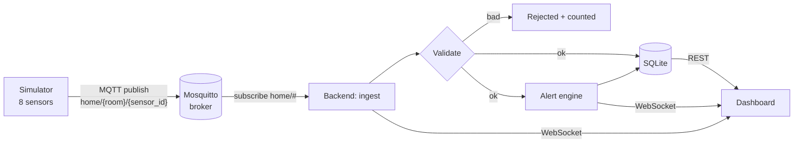

<p align="center"></p>

<h1 align="center">Hearth</h1>

<p align="center"><b>Your home, live.</b><br>Smart home sensor dashboard: simulated sensors over MQTT, a FastAPI backend with threshold alerts, and a live floor-plan dashboard.</p>

[](https://github.com/alok-kul5/hearth-iot/actions/workflows/ci.yml)

A software-only IoT system: a Python simulator stands in for eight home sensors,
publishes their readings over **MQTT** to a **Mosquitto** broker, and a **FastAPI**
backend stores them, checks them against threshold rules and pushes everything to a
live web dashboard over WebSockets. The whole stack starts with one command.


## Quick start

```bash
docker compose up --build
```

Then open <http://localhost:8000>. Readings start arriving within a couple of seconds.
API docs are at <http://localhost:8000/docs>.

## How it works



| Part | What it does |
|---|---|
| `simulator/` | Eight sensors with realistic behaviour: temperatures follow a daily curve plus drift, humidity is a mean-reverting walk, motion fires at random, and doors open and close. Occasional faults (a heat spike, a humidity surge, a door left open) give the alerts something to catch. |
| `mosquitto/` | Broker config. QoS 1 is used for publishing and subscribing so a reading isn't silently dropped. |
| `backend/app/ingest.py` | Validates every message with Pydantic, checks the topic matches the sensor ID, stores it and runs the rules. Malformed messages are rejected and counted, never stored. |
| `backend/app/rules.py` | A small, pure, fully tested rule engine. Rules come from `rules.yaml`. |
| `backend/app/storage.py` | SQLite in WAL mode: raw readings, latest state per sensor, and the alert history. Long time ranges are averaged into about 300 points for the chart, and old readings are pruned after 24 hours. |
| `backend/app/static/` | Dashboard written in plain JavaScript, with Chart.js for the history chart. It loads state over REST, then follows the live feed and reconnects on its own if the connection drops. |

### Sensors

| ID | Room | Type |
|---|---|---|
| `temp-living`, `temp-bedroom`, `temp-kitchen` | living room, bedroom, kitchen | temperature (°C) |
| `hum-living`, `hum-bathroom` | living room, bathroom | humidity (%) |
| `motion-hallway` | hallway | motion |
| `door-front`, `door-back` | entrance, kitchen | door open/closed |

Message format (topic `home/{room}/{sensor_id}`):

```json
{"sensor_id": "temp-kitchen", "room": "kitchen", "type": "temperature", "value": 23.4, "unit": "°C", "ts": 1763571000.0}
```

### Alerts

Rules are in [`backend/app/rules.yaml`](backend/app/rules.yaml):

```yaml
- name: door_left_open
  sensor_type: door
  op: "=="
  threshold: 1
  for_seconds: 60        # must hold for a minute before it fires
  severity: warning
```

- An alert **opens once** when its condition has held for `for_seconds`, so a value that
  stays out of range does not create a new alert every reading.
- It **resolves on its own** when a reading is back in range.
- A sensor that goes quiet for 30 seconds raises a **sensor offline** alert, which clears
  when the sensor reports again.
- Open alerts are reloaded from the database on restart, so a restart doesn't create duplicates.

## API

| Method | Path | Description |
|---|---|---|
| GET | `/api/health` | Broker connection, messages received / rejected, readings stored |
| GET | `/api/sensors` | Latest value and online status for every sensor |
| GET | `/api/sensors/{id}/history?minutes=15` | Time series for a sensor (downsampled) |
| GET | `/api/alerts?active=true&limit=50` | Active or recent alerts |
| GET | `/api/rules` | The rules currently loaded |
| WS | `/ws` | Live stream of `reading` and `alert` messages |

## Development

Run the tests and linter without Docker:

```bash
python -m venv .venv && source .venv/bin/activate   # Windows: .venv\Scripts\activate
pip install -r backend/requirements-dev.txt
cd backend && pytest
cd ../simulator && pytest test_sensors.py
ruff check backend simulator --config backend/pyproject.toml
```

Run the pieces by hand against any broker:

```bash
cd backend && uvicorn app.main:build --factory --reload
cd simulator && python simulator.py --host localhost --interval 1   # add --demo for frequent faults
```

Settings (environment variables): `MQTT_HOST`, `MQTT_PORT`, `MQTT_TOPIC`, `DB_PATH`,
`RULES_PATH`, `RETENTION_HOURS`, and `PUBLISH_INTERVAL` for the simulator.

### CI

GitHub Actions runs lint and unit tests, then starts the **real stack with Docker
Compose** and runs [`scripts/smoke_test.py`](scripts/smoke_test.py). That script checks
that all eight sensors report through Mosquitto into the API.

## Going further

- **Security:** the broker accepts anonymous connections, which is fine inside the
  Compose network. For anything exposed, add `password_file` and TLS listeners to
  `mosquitto.conf` and pass credentials to both clients.
- **Scale:** SQLite is plenty for one home. For many homes, swap `storage.py` for
  TimescaleDB or InfluxDB. The rest of the backend only uses the `Storage` interface.
- **Real hardware:** an ESP32 publishing the same JSON to the same topics would drop
  straight in.

## License

MIT

---

<sub>One of six projects by [Alok Kulkarni](https://alok.is-a.dev): **Hearth** home sensors · [Headway](https://github.com/alok-kul5/headway-transit) transit data · [Vigil](https://github.com/alok-kul5/vigil-soc) security triage · [Loupe](https://github.com/alok-kul5/loupe-vision) defect inspection · [Kharcha](https://github.com/alok-kul5/kharcha-finance) personal finance · [Stockroom](https://github.com/alok-kul5/stockroom-inventory) inventory.</sub>
