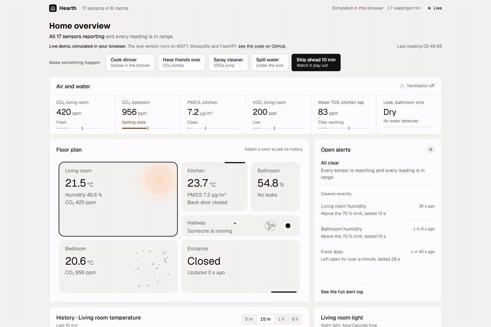
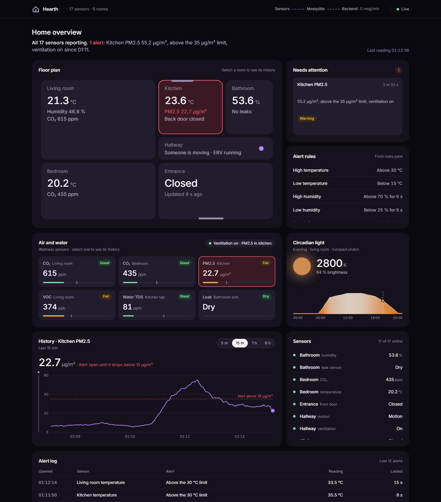
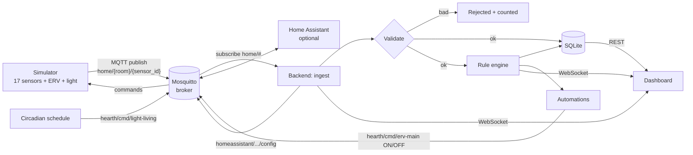

<p align="center"></p>

<h1 align="center">Hearth</h1>

<p align="center"><b>Your home, live.</b><br>A wellness-focused smart home demo: simulated air, water and comfort sensors over MQTT, a FastAPI backend with rules and automations, circadian lighting, Home Assistant discovery, and a live floor-plan dashboard.</p>

<p align="center"><a href="https://alok-kul5.github.io/hearth-iot/"><b>Live demo →</b></a></p>

<p align="center"><a href="https://alok-kul5.github.io/hearth-iot/"></a></p>

[](https://github.com/alok-kul5/hearth-iot/actions/workflows/ci.yml)

The [live demo](https://alok-kul5.github.io/hearth-iot/) runs the same dashboard with the
simulator, rules, automations and circadian schedule ported to JavaScript
([`demo/demo.js`](demo/demo.js)), all running in your browser. It reads its rules from the
real `rules.yaml`. The full stack below uses MQTT, Mosquitto and FastAPI instead.

A software-only IoT system: a Python simulator stands in for seventeen home sensors
and devices, publishes their readings over **MQTT** to a **Mosquitto** broker, and a
**FastAPI** backend stores them, checks them against rules, switches devices when the
air gets stale, and pushes everything to a live web dashboard over WebSockets. Every
sensor also shows up in **Home Assistant** on its own through MQTT Discovery. The whole
stack starts with one command and runs entirely on the local network.

## Features

- **Air quality:** CO2, PM2.5 and VOC sensors that behave like the real thing. CO2
  climbs with the number of people in a room, cooking sends PM2.5 and VOCs up, and a
  cleaning spray gives a VOC spike.
- **Water:** drinking-water TDS (total dissolved solids) with a worn-out-filter fault,
  and a leak sensor under the bathroom sink.
- **Automations:** CO2 above 1000 ppm for 5 minutes, PM2.5 above 35 µg/m³ or VOCs above
  500 ppb switch the ventilation unit (ERV) on over MQTT. It switches off again when the
  last of those alerts clears, with hysteresis so it doesn't flick on and off.
- **Circadian lighting:** a light whose colour temperature and brightness follow the
  time of day, from cool and bright at midday to warm and dim in the evening.
- **Home Assistant:** MQTT Discovery configs for every sensor, grouped into one device
  per room. The ERV appears as a switch that Home Assistant can control.
- **A plan that shows the air:** CO2 and VOCs drift through each room as a haze that
  thickens with the reading and turns red over the limit, cooking smoke rises off the hob,
  the ERV fan spins and pulls air out of every room, a leak ripples under the sink, and the
  living room glows in the light's real colour. All of it is drawn from the live readings.
- **Make something happen:** buttons to cook dinner, have friends over, spray cleaner or
  spill water. Each sends an event to the simulator (`POST /api/simulate/{event}`, MQTT
  `hearth/cmd/sim`), so you can watch the rules and the ventilation respond. The live demo
  adds "Skip ahead 10 min", which plays the next ten minutes as a three-second time-lapse.
- **Drag through the day:** the light's day chart is a scrubber; drag across it to see the
  colour and brightness the light would have at any hour.
- **Alerts:** threshold rules in YAML, offline detection, and a live dashboard with a
  floor plan, history charts and an alert log.



## Quick start

```bash
docker compose up --build
```

Then open <http://localhost:8000>. Readings start arriving within a couple of seconds.
API docs are at <http://localhost:8000/docs>.

## How it works



| Part | What it does |
|---|---|
| `simulator/` | Seventeen sensors with realistic behaviour: temperatures follow a daily curve plus drift, humidity is a mean-reverting walk, motion fires at random, and doors open and close. The wellness sensors share one simulated household (who is home, asleep or cooking, whether the ERV runs), so they react to the same events. Occasional faults (a heat spike, a door left open, a leak, a worn-out water filter) give the alerts something to catch. The simulator also listens on `hearth/cmd/+` for device commands. |
| `mosquitto/` | Broker config. QoS 1 is used for publishing and subscribing so a reading isn't silently dropped. |
| `backend/app/ingest.py` | Validates every message with Pydantic, checks the topic matches the sensor ID, stores it and runs the rules. Malformed messages are rejected and counted, never stored. |
| `backend/app/rules.py` | A small, pure, fully tested rule engine. Rules come from `rules.yaml`. |
| `backend/app/automations.py` | Keeps a device on while any alert that `activates` it is open, and sends `ON` / `OFF` commands over MQTT. |
| `backend/app/circadian.py` | The circadian lighting schedule, and when to send the light a new setpoint. |
| `backend/app/ha_discovery.py` | Builds the Home Assistant MQTT Discovery config for each sensor. |
| `backend/app/storage.py` | SQLite in WAL mode: raw readings, latest state per sensor, and the alert history. Long time ranges are averaged into about 300 points for the chart, and old readings are pruned after 24 hours. |
| `backend/app/static/` | Dashboard in plain JavaScript with hand-drawn SVG charts and no framework. The house's one answer is set large on a deep-green field beside the floor plan; the rest sits in quiet panels, with colour only on readings that are out of range and on the light itself. It loads state over REST, then follows the live feed and reconnects on its own if the connection drops. |

### Sensors

| ID | Room | Type |
|---|---|---|
| `temp-living`, `temp-bedroom`, `temp-kitchen` | living room, bedroom, kitchen | temperature (°C) |
| `hum-living`, `hum-bathroom` | living room, bathroom | humidity (%) |
| `co2-living`, `co2-bedroom` | living room, bedroom | CO2 (ppm) |
| `pm25-kitchen` | kitchen | PM2.5 (µg/m³) |
| `voc-living` | living room | total VOCs (ppb) |
| `tds-kitchen` | kitchen | drinking-water TDS (ppm) |
| `leak-bathroom` | bathroom | water leak wet/dry |
| `erv-main` | hallway | ventilation unit on/off (takes commands) |
| `light-living-kelvin`, `light-living-level` | living room | circadian light colour temperature (K) and brightness (%) |
| `motion-hallway` | hallway | motion |
| `door-front`, `door-back` | entrance, kitchen | door open/closed |

Message format (topic `home/{room}/{sensor_id}`):

```json
{"sensor_id": "temp-kitchen", "room": "kitchen", "type": "temperature", "value": 23.4, "unit": "°C", "ts": 1763571000.0}
```

### Alerts

Rules are in [`backend/app/rules.yaml`](backend/app/rules.yaml):

```yaml
- name: door_left_open
  sensor_type: door
  op: "=="
  threshold: 1
  for_seconds: 60        # must hold for a minute before it fires
  severity: warning
```

- An alert **opens once** when its condition has held for `for_seconds`, so a value that
  stays out of range does not create a new alert every reading.
- It **resolves on its own** when a reading is back in range.
- A sensor that goes quiet for 30 seconds raises a **sensor offline** alert, which clears
  when the sensor reports again.
- Open alerts are reloaded from the database on restart, so a restart doesn't create duplicates.
- `clear_at` adds hysteresis: a CO2 alert that opened above 1000 ppm stays open until
  CO2 is back under 800 ppm.
- `activates: [erv-main]` keeps the ERV on while the alert is open (see below).

## Wellness

The air and water rules follow common indoor-environment guidance:

| Rule | Condition | Action |
|---|---|---|
| `co2_high` | CO2 > 1000 ppm for 5 min, clears below 800 ppm | warning, ERV on |
| `pm25_high` | PM2.5 > 35 µg/m³ (US EPA daily standard) for 30 s, clears below 15 (WHO 24 h guideline) | warning, ERV on |
| `voc_high` | VOCs > 500 ppb for 60 s, clears below 300 ppb | warning, ERV on |
| `water_leak` | leak sensor wet | critical alert |
| `tds_high` | drinking-water TDS > 300 ppm | warning, check the filter |
| `tds_low` | drinking-water TDS < 30 ppm | warning |

**How the simulation behaves.** Each person in a room adds CO2 and air exchange pulls it
back towards the outdoor level (about 420 ppm). With two people asleep and the windows
shut, the bedroom passes 1000 ppm during the night, which is what happens in many real
bedrooms. Cooking at meal times sends kitchen PM2.5 well past 35 µg/m³. When the ERV runs,
the exchange rate goes up roughly tenfold and all three levels fall. Time is compressed so
the changes take minutes rather than hours.

**Automations.** The backend publishes `ON` / `OFF` to `hearth/cmd/erv-main` (retained, so
a device that restarts picks up its state). Several rules can ask for the same device; it
stays on until the last one clears, so the bedroom CO2 clearing doesn't stop the ERV while
the kitchen is still smoky. `GET /api/automations` shows each device and which alerts are
keeping it on.

**Circadian lighting.** The backend sends the living-room light a setpoint every time the
schedule moves (`hearth/cmd/light-living`, e.g. `{"color_temp_k": 4000, "brightness": 80}`)
and the light reports what it shows:

| Time | Colour temperature | Brightness |
|---|---|---|
| 23:00 to 05:30 | 1800 K (amber night light) | 3–5 % |
| 06:30 to 08:00 | 2400 K rising to 4000 K | 30 → 80 % |
| 12:00 | 5500 K | 100 % |
| 18:00 | 3500 K | 85 % |
| 20:00 to 22:00 | 2700 K falling to 2200 K | 60 → 25 % |

Between keyframes it fades in a straight line. The schedule uses the home's time zone
(`TIMEZONE`, e.g. `Asia/Kolkata`).

## Low-EMF and local-first

- **Nothing leaves the house.** Mosquitto, the backend, the dashboard and Home Assistant
  all run on the local network. There is no cloud service, account or internet connection
  in the data path, so the home keeps working when the internet is down.
- **One wired hub, quiet radios.** The backend and broker can run together on one
  small, wired machine (Ethernet, no Wi-Fi needed). The protocol is plain MQTT, so real
  sensors can be wired (KNX, Modbus, Ethernet) or low-duty-cycle radios such as Zigbee,
  Thread or Matter devices that sleep between reports, instead of chatty always-on Wi-Fi.
  This repo only simulates the sensors; choosing the hardware is where the EMF exposure
  is actually decided.
- **Reports, not streams.** Sensors publish small readings every couple of seconds in the
  demo; on real battery sensors this would be every minute or on change.
- **Open and replaceable.** Every part speaks MQTT and JSON, so any piece (the broker, the
  dashboard, Home Assistant) can be swapped without touching the others.

## Home Assistant

Hearth uses [MQTT Discovery](https://www.home-assistant.io/integrations/mqtt/#mqtt-discovery),
so Home Assistant creates the entities on its own:

1. Point Home Assistant's MQTT integration at the same Mosquitto broker.
2. Start Hearth. For each sensor the backend publishes a retained config to
   `homeassistant/<component>/hearth/<sensor_id>/config`.

You get one device per room (`Hearth Living room`, `Hearth Kitchen`, ...) with
`sensor` entities for temperature, humidity, CO2, PM2.5, VOC, water TDS and the light,
`binary_sensor` entities for motion, doors and the leak sensor, and a `switch` for the
ERV. Device classes and units are set, so the values show up in the right cards and in
long-term statistics. Entities go unavailable if a sensor is quiet for 30 seconds or the
backend goes offline (a retained last-will on `hearth/status`). When Home Assistant
restarts it publishes `online` on `homeassistant/status` and Hearth sends the configs
again. `GET /api/homeassistant/discovery` shows exactly what is published.

Example config for the CO2 sensor in the bedroom:

```json
{
  "name": "CO2",
  "unique_id": "hearth_co2-bedroom",
  "state_topic": "home/bedroom/co2-bedroom",
  "value_template": "{{ value_json.value }}",
  "device_class": "carbon_dioxide",
  "unit_of_measurement": "ppm",
  "state_class": "measurement",
  "expire_after": 30,
  "availability_topic": "hearth/status",
  "device": {"identifiers": ["hearth_bedroom"], "name": "Hearth Bedroom", "suggested_area": "Bedroom"}
}
```

Example Home Assistant automations using those entities (entity IDs are what Home
Assistant generates from the device and entity names; check yours under
*Settings → Devices*):

```yaml
automation:
  - alias: "Bedroom air is stale: run the ERV and tell me"
    trigger:
      - platform: numeric_state
        entity_id: sensor.hearth_bedroom_co2
        above: 1000
        for: "00:05:00"
    action:
      - service: switch.turn_on
        target:
          entity_id: switch.hearth_hallway_ventilation
      - service: notify.notify
        data:
          message: "Bedroom CO2 is {{ states('sensor.hearth_bedroom_co2') }} ppm, ventilation on."

  - alias: "Water leak under the bathroom sink"
    trigger:
      - platform: state
        entity_id: binary_sensor.hearth_bathroom_leak
        to: "on"
    action:
      - service: notify.notify
        data:
          message: "Water detected under the bathroom sink."
```

How this was tested: the discovery payloads are covered by unit tests
(`backend/tests/test_ha_discovery.py`: every sensor type, unique IDs and topics,
device classes and units as Home Assistant spells them, the binary value template
rendered with Jinja2). CI then starts the real stack and checks that all 17 configs are
retained on Mosquitto. Home Assistant itself was not run for this project.

## API

| Method | Path | Description |
|---|---|---|
| GET | `/api/health` | Broker connection, messages received / rejected, readings stored |
| GET | `/api/sensors` | Latest value and online status for every sensor |
| GET | `/api/sensors/{id}/history?minutes=15` | Time series for a sensor (downsampled) |
| GET | `/api/alerts?active=true&limit=50` | Active or recent alerts |
| GET | `/api/rules` | The rules currently loaded |
| GET | `/api/automations` | Devices switched by rules, their state, and which alerts keep them on |
| GET | `/api/circadian` | The light's schedule for the day and the current setpoint |
| GET | `/api/homeassistant/discovery` | The MQTT Discovery configs published for Home Assistant |
| POST | `/api/simulate/{event}` | Start `cooking`, `guests`, `spray` or `leak` in the simulated home (off with `SIMULATOR_CONTROLS=0`) |
| WS | `/ws` | Live stream of `reading`, `alert` and `automation` messages |

## Development

Run the tests and linter without Docker:

```bash
python -m venv .venv && source .venv/bin/activate   # Windows: .venv\Scripts\activate
pip install -r backend/requirements-dev.txt
cd backend && pytest
cd ../simulator && pytest test_sensors.py
ruff check backend simulator --config backend/pyproject.toml
```

Run the pieces by hand against any broker:

```bash
cd backend && uvicorn app.main:build --factory --reload
cd simulator && python simulator.py --host localhost --interval 1   # add --demo for frequent faults
```

Settings (environment variables): `MQTT_HOST`, `MQTT_PORT`, `MQTT_TOPIC`, `DB_PATH`,
`RULES_PATH`, `RETENTION_HOURS`, `TIMEZONE` (both services), `HA_DISCOVERY` (`1`/`0`),
`HA_DISCOVERY_PREFIX` (default `homeassistant`), `CIRCADIAN` (`1`/`0`), and
`PUBLISH_INTERVAL` for the simulator.

### CI

GitHub Actions runs lint and unit tests, then starts the **real stack with Docker
Compose** and runs [`scripts/smoke_test.py`](scripts/smoke_test.py). That script checks
that all 17 sensors report through Mosquitto into the API, then CI checks that the 17
Home Assistant discovery configs are retained on the broker.

## Going further

- **Security:** the broker accepts anonymous connections, which is fine inside the
  Compose network. For anything exposed, add `password_file` and TLS listeners to
  `mosquitto.conf` and pass credentials to both clients.
- **Scale:** SQLite is plenty for one home. For many homes, swap `storage.py` for
  TimescaleDB or InfluxDB. The rest of the backend only uses the `Storage` interface.
- **Real hardware:** an ESP32 publishing the same JSON to the same topics would drop
  straight in, for example with a Sensirion SCD41 (CO2), SPS30 (PM2.5) or SGP41 (VOC).
  Zigbee sensors could come in through Zigbee2MQTT with a small topic mapping.

## License

MIT

---

<sub>One of eight projects by [Alok Kulkarni](https://alok.is-a.dev): **Hearth** home sensors · [Headway](https://github.com/alok-kul5/headway-transit) transit data · [Vigil](https://github.com/alok-kul5/vigil-soc) security triage · [Loupe](https://github.com/alok-kul5/loupe-vision) defect inspection · [Kharcha](https://github.com/alok-kul5/kharcha-finance) personal finance · [Stockroom](https://github.com/alok-kul5/stockroom-inventory) inventory · [Quietwire](https://github.com/alok-kul5/quietwire-villa) smart home design · [Canopy](https://alok.is-a.dev/canopy/) coffee storefront.</sub>
